# Documentação do Projeto NivelTec – Monitoramento de Nível de Água (V1.0)

### Equipe:
* Prof. João Batista dos Santos Filho
* Prof. Alan Vinícios Santos Sá
* Gyovanna Luiza Menezes Santos Freire
* Nicole Beatriz Santana Santos
* Luís Vítor Santos Fontes 

## 1. Introdução

A gestão eficiente dos recursos hídricos é um dos maiores desafios da atualidade, especialmente em regiões semiáridas, onde as altas temperaturas intensificam a evaporação. No contexto da agricultura e da piscicultura, essa perda representa um fator crítico: a primeira demanda um planejamento rigoroso de irrigação, enquanto a segunda exige a estabilidade do volume e da qualidade da água para a sobrevivência dos peixes. O método padrão para mensurar essa evaporação é o Tanque Evaporimétrico Classe A. Contudo, o monitoramento manual desse dispositivo apresenta sérias limitações, como a necessidade de leituras diárias, a suscetibilidade a erros humanos e o alto custo de mão de obra contínua.

Embora existam sensores eletrônicos comerciais (como radares e transdutores de pressão) capazes de automatizar o processo, seu custo elevado inviabiliza a adoção em larga escala, especialmente na agricultura familiar. Nesse cenário, o projeto NivelTec propõe uma solução de Internet das Coisas (IoT) de baixo custo, utilizando o microcontrolador ESP32-S2 Mini e sensores ópticos de tempo de voo (ToF) VL53L0X.

Para superar as limitações inerentes aos sensores de baixo custo (ruídos e baixa precisão milimétrica), o firmware foi dotado de uma arquitetura matemática robusta. O sistema aplica um Filtro de Mediana para rejeitar picos de ruído, realiza uma Calibração Geométrica por semelhança de triângulos (anulando diferenças físicas de montagem entre os dois sensores) e executa a Fusão de Dados (Filtro de Kalman). Essa combinação garante a extração de medições com incerteza na casa dos décimos de milímetro, utilizando hardware acessível.

Por fim, todo o processamento local é integrado a uma plataforma em nuvem (Firebase). Os dados são enviados de forma segura e, em caso de falha de conexão, são armazenados localmente (LittleFS) para não haver perda de histórico. A interface de controle é uma aplicação web responsiva que permite ao usuário visualizar a evolução do nível em tempo real, acompanhar as incertezas estatísticas, configurar o hardware remotamente e executar a calibração à distância, tudo isso com foco em baixo consumo de energia (Deep Sleep) para operação prolongada em campo.

---

## 2. Objetivos

- Medir periodicamente a distância até a superfície da água utilizando dois sensores laser.
- Aplicar **Filtro de Mediana** (Snapshot) para rejeição de ruídos (outliers) nas leituras brutas.
- Realizar **Calibração Geométrica** (semelhança de triângulos) para anular o *offset* físico entre os sensores.
- Executar a **Fusão de Dados (Filtro de Kalman)** para calcular o nível real com a menor incerteza possível.
- Transmitir os dados tratados e seus respectivos erros (desvios padrão) para a nuvem (Firebase).
- Permitir configuração remota de parâmetros e **Calibração Remota** via interface web.
- Proporcionar interface local com display OLED, botão para ligar/desligar o display e LED para indicar estado de conexão.
- Economizar energia através de deep sleep quando configurado.
- Garantir a integridade dos dados através de armazenamento local em caso de falha de conexão (LittleFS).
- Registrar informações persistentes do dispositivo (MAC, IP, timestamps de inicialização, contador de boots, versão do firmware) para diagnóstico e histórico.

---

## 3. Arquitetura Geral

O sistema é composto por três camadas principais:

1. **Firmware** – Código executado no ESP32-S2 Mini (FreeRTOS), responsável por ler sensores, processar a matemática (Kalman) e comunicar-se com o Firebase.
2. **Firebase** – Plataforma na nuvem (BaaS) que armazena dados, parâmetros de configuração e comandos de calibração.
3. **Aplicação Web** – Interface responsiva (HTML/Tailwind) que permite ao usuário visualizar gráficos, gerenciar dispositivos e enviar comandos de calibração.

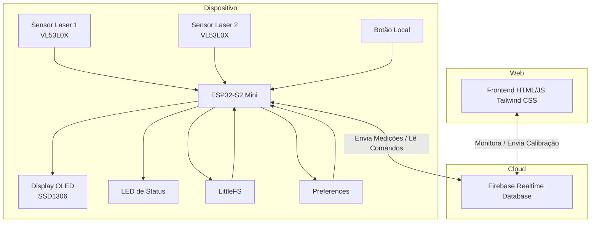

---

## 4. Firmware (ESP32-S2 Mini)

### 4.1 Hardware e Pinos

| Componente     | Pino(s)        | Descrição                                 |
| -------------- | -------------- | ----------------------------------------- |
| LED de status  | GPIO15         | Indica estado de conexão                  |
| Botão local    | GPIO0          | Liga/desliga display (pull‑up interno)    |
| I2C (SDA/SCL)  | GPIO33, GPIO35 | Comunicação com sensores e display        |
| XSHUT Sensor 1 | GPIO39         | Reset do primeiro VL53L0X (Endereço 0x30) |
| XSHUT Sensor 2 | GPIO37         | Reset do segundo VL53L0X (Endereço 0x31)  |
| Display OLED   | I2C (0x3C)     | SSD1306, 128×64                           |

### 4.2 Principais Funcionalidades

- **Inicialização**: WiFiManager padrão para configuração da rede; sincronização NTP (UTC‑3); autenticação no Firebase.
- **Identificador do dispositivo (deviceId)**: Gerado a partir do MAC via CRC‑32 com 4 bits de paridade → 9 caracteres hex (ex: `A1B2C3D4E`). O ID é armazenado em `Preferences` e utilizado como chave no banco.
- **Snapshot Mediano (Filtro de Mediana)**: Para cada amostra, o sistema lê o sensor 5 vezes e extrai a mediana. Isso descarta picos de ruído (outliers) sem travar o processador.
- **Calibração Geométrica**: Utiliza o método de semelhança de triângulos para calcular a altura real (\(y\)) independentemente do ângulo de montagem, anulando o offset físico de ~34 mm entre os sensores.
- **Fusão de Dados (Filtro de Kalman)**: Após calcular a média e o desvio padrão das amostras limpas, aplica a fusão por mínima variância para calcular o `y_fusao` e o `sigma_y` (incerteza final).
- **Configuração Remota**: A cada 5 segundos, o firmware lê o nó `/dispositivos/[deviceId]/config` e atualiza parâmetros internos.
- **Calibração Remota**: O firmware monitora o nó `comando_calibracao`. Ao receber `base`, `nivel_x` ou `reset`, executa a Máquina de Estados de calibração e avisa o site (via nó `calibracao`).
- **Armazenamento local (LittleFS)**: Quando o envio falha, os dados completos (médias, desvios e y_fusao) são salvos em `/pendentes.json`. Ao reconectar, são automaticamente reenviados. Pendentes com timestamp inválido (0) são descartados.
- **Informações persistentes do dispositivo**: Classe `DeviceInfo` armazena em `Preferences` MAC, IP, timestamps de primeira/última inicialização, contador de boots e versão do firmware. Esses dados são enviados ao Firebase no nó `/info`.
- **Modo de operação**:
  - `sempreAtivo`: o sistema aguarda o intervalo entre medições usando `vTaskDelay`.
  - `hibernar`: após enviar os dados, o ESP entra em deep sleep por `intervalo` segundos, desligando display e Wi‑Fi.
- **Tarefas FreeRTOS**: Múltiplas tarefas executam em paralelo (comunicação, medição, display, botão, LED, verificação de reconexão). Mutexes protegem acesso ao barramento I2C e à estrutura de configuração.

### 4.3 Bibliotecas Utilizadas

| Biblioteca                    | Finalidade                                 |
| ----------------------------- | ------------------------------------------ |
| `WiFiManager` (2.0.17)        | Configuração Wi‑Fi com portal captivo      |
| `Firebase_ESP_Client` (4.4.0) | Comunicação com Firebase Realtime DB       |
| `NTPClient` (3.2.0)           | Sincronização de horário                   |
| `Adafruit_VL53L0X` (1.3.0)    | Leitura dos sensores laser                 |
| `Adafruit_SSD1306` (2.5.13)   | Controle do display OLED                   |
| `Preferences` (embutida)      | Armazenamento persistente de configurações |
| `LittleFS` (embutida)         | Sistema de arquivos para dados pendentes   |
| `ArduinoJson` (6.21.5)        | Manipulação de JSON para pendentes         |
| `CRC32` (opcional)            | Cálculo do CRC‑32 para geração do deviceId |

### 4.4. Arquitetura de Software: FreeRTOS, Tarefas e a Máquina de Estados

Esta seção detalha como o firmware do NivelTec foi organizado internamente. O objetivo é permitir que qualquer estudante ou desenvolvedor compreenda a lógica do sistema ao abrir o código. O firmware **não utiliza a programação linear tradicional** (onde o `loop()` executa tudo em sequência), mas sim uma arquitetura baseada em **Sistema Operacional de Tempo Real (FreeRTOS)**.

#### 4.4.1. O Paradigma FreeRTOS e o `loop()` Vazio

Na programação Arduino tradicional, o `setup()` configura o hardware e o `loop()` executa a lógica principal em um ciclo infinito. Se uma rotina demorar muito (ex: ler o sensor por 5 segundos), todo o sistema "congela" e a comunicação Wi-Fi ou o display param de responder.

No NivelTec, o `loop()` está intencionalmente **vazio**:

```cpp
void loop() {
  vTaskDelay(1000 / portTICK_PERIOD_MS);
}
```

Toda a inteligência do sistema foi movida para o `setup()`, que, logo ao final, **cria as tarefas (Tasks)** do FreeRTOS. A partir daí, a biblioteca do FreeRTOS assume o controle do processador. Ela age como um "maestro" (escalonador ou *Scheduler*), decidindo qual tarefa deve rodar em cada milissegundo, garantindo que todas avancem em paralelo sem que uma trave as outras.

#### 4.4.2. As Tarefas (Tasks) do Sistema

Foram criadas seis tarefas independentes no `setup()` via `xTaskCreate`:

| Tarefa                      | Prioridade | Ciclo de Execução | Responsabilidade                                                      |
|:--------------------------- |:---------- |:----------------- |:--------------------------------------------------------------------- |
| **`tarefaComunicacao`**     | 2          | 5 segundos        | Lê o Firebase (configurações e comandos) e aplica no sistema.         |
| **`tarefaMedicao`**         | 1          | Contínuo (50 ms)  | Gerencia a Máquina de Estados de coleta e processamento dos sensores. |
| **`tarefaDisplay`**         | 1          | 1 segundo         | Atualiza os dados na tela OLED.                                       |
| **`tarefaBotao`**           | 1          | 50 ms             | Faz o *debounce* e lê o botão físico (liga/desliga display).          |
| **`tarefaLED`**             | 1          | Variável          | Pisca o LED indicando estado da conexão.                              |
| **`tarefaVerificaConexao`** | 1          | 2 segundos        | Monitora a reconexão e dispara o reenvio de dados pendentes.          |

Cada tarefa possui um `vTaskDelay()` interno. Isso é necessario: ao executar essa função, a tarefa avisa ao FreeRTOS que está "pausada", liberando o processador para as outras tarefas rodarem. É por isso que a `tarefaMedicao` consegue esperar 250 ms entre amostras sem travar o sistema.

#### 4.4.3. A Máquina de Estados da Medição

A `tarefaMedicao` é o coração do firmware. Para não travar o sistema enquanto coleta 50 amostras (o que levaria vários segundos), ela foi estruturada como uma **Máquina de Estados** não-bloqueante.

O sistema possui 4 estados possíveis, definidos no `enum`:

1. **`IDLE`**: Estado de espera. A tarefa apenas verifica se o tempo do `intervaloMedicao` já passou. Se sim, muda para `MEDINDO`.
2. **`MEDINDO`**: O ESP32 está coletando as 50 amostras da medição normal de evaporação.
3. **`COLETANDO_BASE`**: O usuário solicitou a calibração da base pelo site. O ESP32 coleta 50 amostras e salva em `Calibracao::setBase()`.
4. **`COLETANDO_NIVEL_X`**: O usuário solicitou a calibração do nível conhecido. O ESP32 coleta 50 amostras e salva em `Calibracao::setNivelX()`.

O diagrama abaixo ilustra o fluxo de transições da Máquina de Estados:

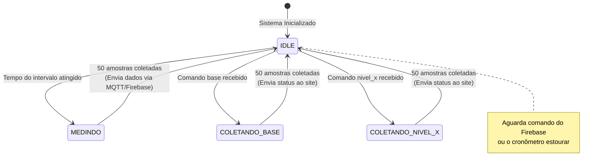

**Como funciona a coleta dentro do estado ativo?**
Em cada ciclo da máquina (a cada 50 ms), a função `lerMedianaSensores()` executa 5 leituras rápidas, extrai a mediana (descartando ruídos) e incrementa um contador (`amostrasColetadas`). Quando o contador atinge 50, o ESP32 calcula a média, o desvio padrão e transita de volta para `IDLE`.

#### 4.4.4. Os Mutexes (Semáforos de Exclusão Mútua)

Como o FreeRTOS permite que tarefas "pareçam" rodar ao mesmo tempo, existe um risco grave: **duas tarefas tentarem acessar o mesmo periférico simultaneamente**. Por exemplo, a `tarefaMedicao` tentar ler o sensor I2C enquanto a `tarefaDisplay` tenta desenhar na tela OLED (que também usa I2C). Isso causaria colisão de dados e travamento.

Para evitar isso, usamos três **Mutexes** (MUTual EXclusion - Exclusão Mútua), que funcionam como "chaves de cadeado":

1. **`xI2CMutex`**: Protege o barramento I2C. Antes de ler o sensor ou atualizar o display, a tarefa precisa "pegar a chave" com `xSemaphoreTake()`. Se outra tarefa estiver usando o barramento, ela espera na fila. Ao terminar, devolve a chave com `xSemaphoreGive()`.
2. **`xConfigMutex`**: Protege a estrutura `configAtual`. Impede que a `tarefaComunicacao` altere o intervalo de medição no exato momento em que a `tarefaMedicao` está lendo esse valor.
3. **`xPendentesMutex`**: Protege o arquivo `/pendentes.json` no LittleFS. Impede que duas tarefas tentem escrever ou ler o arquivo ao mesmo tempo.

#### 4.4.5. Resumo Visual da Orquestração

O diagrama abaixo mostra como todas as peças se encaixam em um ciclo de vida completo:

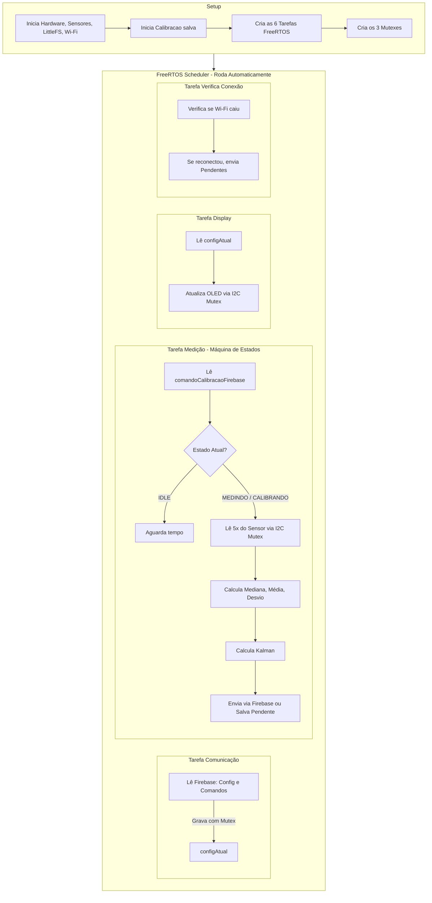

O `loop()` vazio na parte inferior do código é a prova de que o sistema foi delegado ao FreeRTOS: a partir do momento em que as tarefas são criadas no `setup()`, o escalonador do sistema operacional assume o controle, alternando entre as tarefas de forma preemptiva (por prioridade) e cooperativa (por meio dos `vTaskDelay`), garantindo o funcionamento simultâneo, seguro e contínuo do monitoramento.

---

## 5. Banco de Dados (Firebase Realtime Database)

### 5.1 Estrutura de Dados

```json
{
  "dispositivos": {
    "[deviceId]": {
      "estado": "ativo",
      "comando_calibracao": "nenhum",
      "calibracao": { "calibrado": true, "timestamp": 1774906209 },
      "info": {
        "mac": "CC:8D:A2:88:B2:08",
        "ip": "192.168.1.104",
        "firstBoot": 1774906209,
        "lastBoot": 1774983041,
        "bootCount": 28,
        "firmwareVersion": "1.0.0",
        "status": "ativo",
        "lastUpdate": 1774983041
      },
      "config": {
        "intervaloMedicao": 600,
        "amostrasMedia": 50,
        "modoEnvio": "ambos",
        "modoOperacao": "sempreAtivo",
        "displayLigado": true,
        "valorX": 29.8
      },
      "medicoes": {
        "1774906210": {
          "sensor1_dist": 450.5,
          "sensor1_desv": 0.8,
          "sensor2_dist": 485.2,
          "sensor2_desv": 2.7,
          "nivel_y": 30.1,
          "sigma_y": 0.5,
          "timestamp": 1774906210
        }
      }
    }
  },
  "users": {
    "[uid]": {
      "nome": "João",
      "email": "joao@email.com",
      "createdAt": 1774906209,
      "dispositivos": {
        "[deviceId]": {
          "apelido": "Tanque Norte",
          "timestamp": 1774906209
        }
      }
    }
  },
  "admins": { "[uid]": true }
}
```

### 5.2 Regras de Segurança

```json
{
  "rules": {
    "users": {
      "$uid": {
        ".read": "$uid === auth.uid",
        ".write": "$uid === auth.uid",
        "dispositivos": {
          "$deviceId": { ".read": "$uid === auth.uid", ".write": "$uid === auth.uid" }
        }
      }
    },
    "dispositivos": {
      "$deviceId": {
        ".read": "auth != null",
        ".write": "auth != null",
        "info": { ".read": true, ".write": false },
        "estado": { ".read": true, ".write": "auth != null" },
        "ultimaLeitura": { ".read": true, ".write": "auth != null" },
        "config": {
          ".read": true,
          ".write": "root.child('admins').child(auth.uid).val() === true"
        },
        "comando_calibracao": {
          ".read": true,
          ".write": "root.child('admins').child(auth.uid).val() === true"
        },
        "calibracao": {
          ".read": true,
          ".write": "auth != null"
        },
        "medicoes": {
          ".read": true,
          ".write": "auth != null",
          "$timestamp": {
            ".validate": "newData.hasChildren(['sensor1_dist', 'sensor2_dist', 'nivel_y', 'timestamp'])"
          }
        }
      }
    },
    "admins": {
      "$uid": {
        ".read": false,
        ".write": false,
        ".validate": "newData.isBoolean() && newData.val() === true"
      }
    }
  }
}
```

**Explicação das regras**:

- Cada usuário só pode ler/escrever seus próprios dados no nó `users`.
- Qualquer usuário autenticado pode ler informações básicas dos dispositivos e criar novas medições.
- Apenas administradores (UID listados em `admins`) podem alterar a configuração (`config`) e enviar comandos de calibração (`comando_calibracao`).
- O nó `info` é somente leitura para todos, para preservar o histórico do dispositivo.
- O ESP32 (autenticado) pode escrever no nó `calibracao` para avisar o site que o processo terminou.

---

## 6. Fluxos Principais (Detalhados)

### 6.1 Inicialização do Sistema

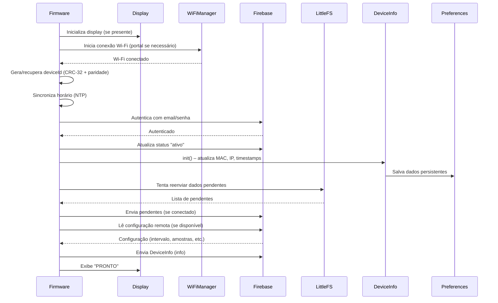

### 6.2 Ciclo de Medição (Com Mediana e Kalman)

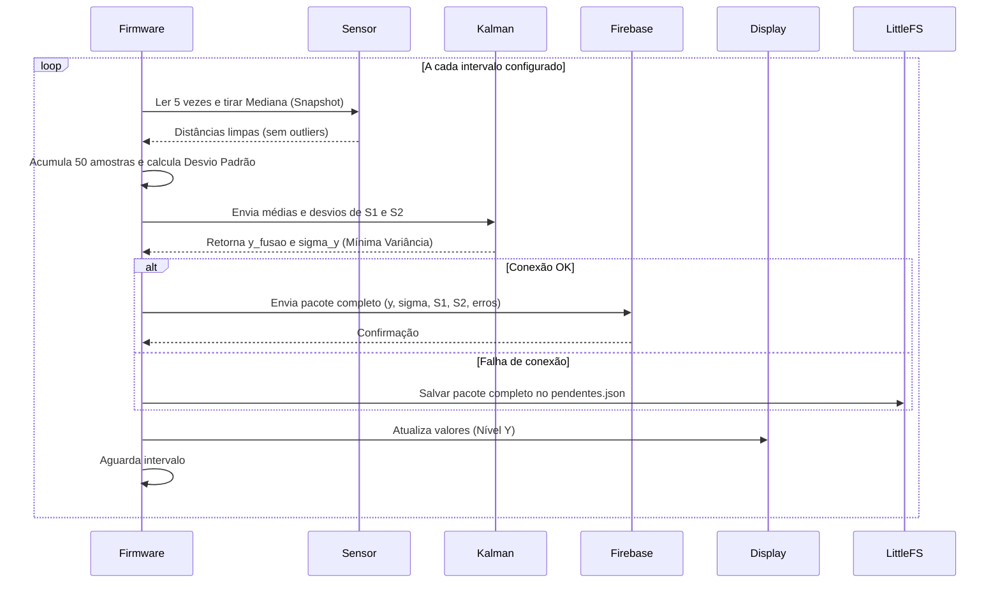

### 6.3 Recuperação de Dados Pendentes

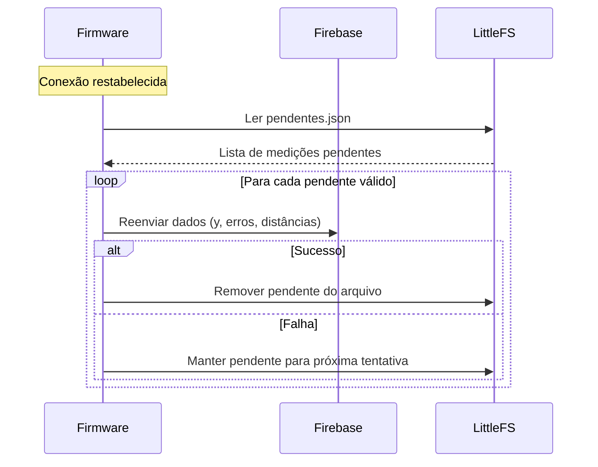

### 6.4 Calibração Remota (Site <-> ESP32)

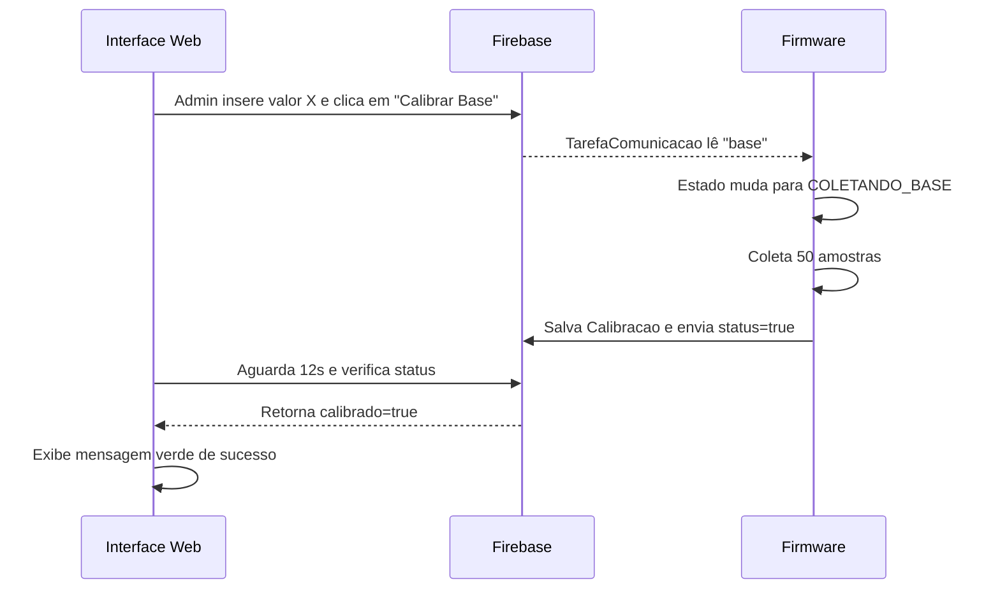

### 6.5 Leitura de Configuração Remota

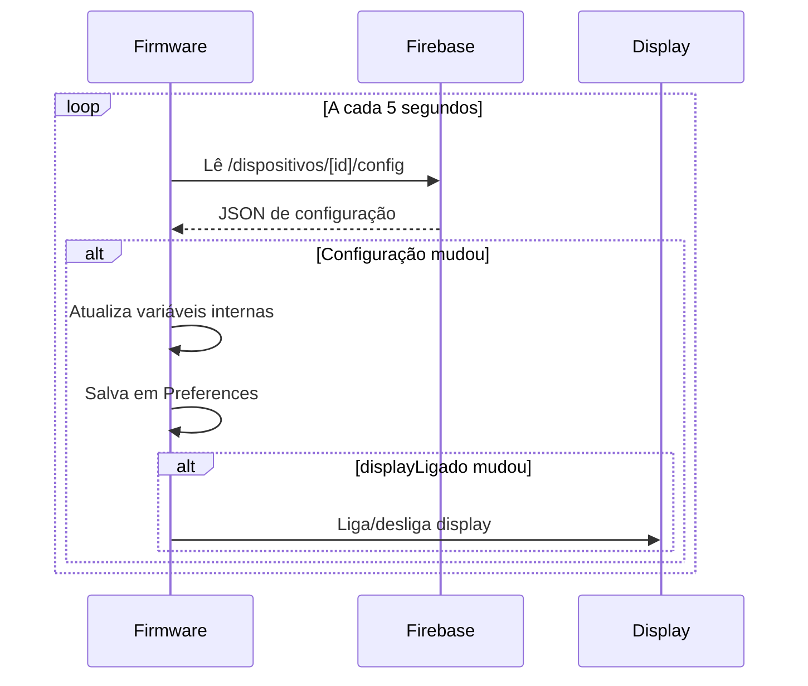

### 6.6 Modo Hibernação (Deep Sleep)

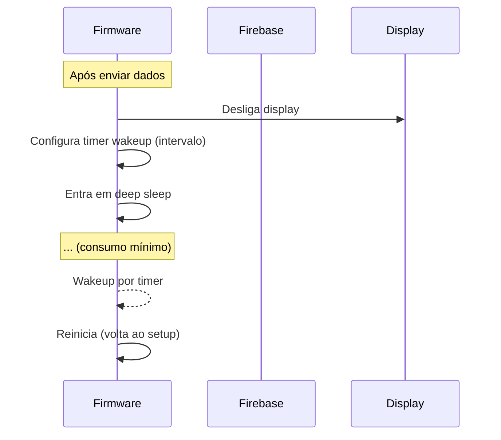

### 6.7 Interação com Botão

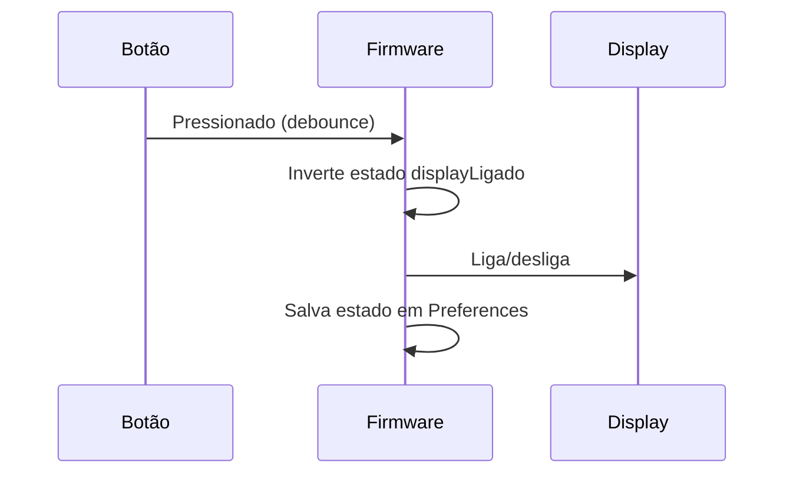

---

## 7. Aplicação Web (Frontend)

### 7.1 Estrutura de Páginas

| Página                | Rota                        | Funcionalidade                                                                                                                             |
| --------------------- | --------------------------- | ------------------------------------------------------------------------------------------------------------------------------------------ |
| Login                 | `login.html`                | Autenticação com email/senha ou Google; tratamento de parâmetro `?device=`                                                                 |
| Cadastro              | `cadastro.html`             | Criação de nova conta; associação automática de dispositivo, se presente                                                                   |
| Adicionar Dispositivo | `cadastro-dispositivo.html` | Leitura de código (digitação ou QR Code) e associação ao usuário                                                                           |
| Meus Dispositivos     | `dispositivos.html`         | Lista todos os dispositivos do usuário; permite renomear, remover e acessar                                                                |
| Dashboard             | `index.html`                | **Simplificado:** Exibe apenas o Nível d'água (`y_fusao`) e a incerteza (`sigma_y`) no formato `30,1(5)`. Alerta se não estiver calibrado. |
| Tabela e Gráficos     | `tabela.html`               | Histórico completo. Gráfico com área de incerteza sombreada. Tabela com formato científico. Botão de apagar histórico (admin).             |
| Configurações         | `configuracoes.html`        | Edita parâmetros (admin) e possui a interface de **Calibração Remota** com botões e feedback visual.                                       |
| Gerar QR Code         | `gerarqrcode.html`          | Ferramenta administrativa para gerar etiquetas físicas com QR Code para associar o hardware.                                               |

### 7.2 Funcionalidades Comuns

- **Autenticação**: Todos os acessos exigem login. Redirecionamento automático para login se usuário não autenticado.
- **Parâmetro `device` na URL**: Mantém o contexto do dispositivo selecionado, passado entre páginas.
- **Atualização em tempo real**: Uso de listeners do Firebase (`on('value')`) para refletir alterações instantâneas.
- **Formatação de data/hora**: Os timestamps Unix (segundos) são convertidos para UTC usando `new Date(timestamp * 1000).toLocaleString('pt-BR', { timeZone: 'UTC' })`.
- **Exportação CSV**: Geração de arquivo com cabeçalho e dados no formato adequado (ponto e vírgula como delimitador, encoding UTF‑8 com BOM).

### 7.3 Estilo e Responsividade

- Utiliza **Tailwind CSS** para layout responsivo.
- Cores principais: verde (#14532d) e azul (#1e3a8a) com gradiente.
- Ícones: Font Awesome 6.
- Gráficos: Chart.js com preenchimento de área para representar a incerteza.

---

## 8. Diagrama de Classes

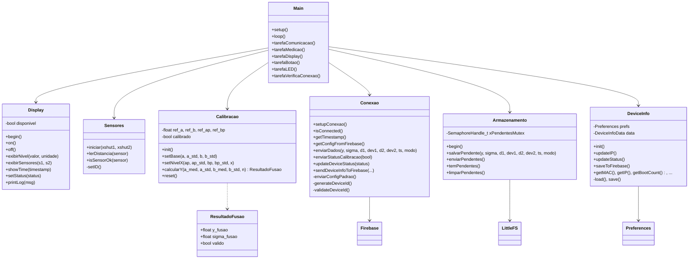

---

## 9. Decisões Técnicas Importantes

### 9.1 Uso do WiFiManager Padrão

Optou-se pelo `WiFiManager` tradicional (síncrono) em vez da versão assíncrona devido a:

- **Menor complexidade de instalação** – todas as dependências estão disponíveis no Library Manager.
- **Consumo de recursos** – a versão síncrona consome menos flash e RAM, deixando mais espaço para o código de aplicação e para futuras implementações como OTA.
- **Confiabilidade** – funciona de forma estável no ESP32-S2.
- **Raridade de uso** – o portal de configuração só é acionado na primeira inicialização ou quando não há credenciais salvas.

### 9.2 Geração do DeviceId

O identificador do dispositivo é gerado a partir do MAC via CRC‑32 (32 bits) + 4 bits de paridade (XOR dos bytes do CRC). Resultado: 9 caracteres hex. Vantagens:

- Ofusca o MAC original (não exposto no banco).
- Permite detecção de erros de digitação no frontend.
- Determinístico (mesmo ID para o mesmo hardware).

### 9.3 Uso de Dois Sensores VL53L0X com Mediana e Kalman

A redundância de dois sensores permite não só a fusão de dados (reduzindo erros), mas também a implementação da **Calibração Geométrica**. Para combater o ruído óptico (que é maior no sensor sem lente), o firmware aplica o **Snapshot Mediano** (5 leituras, descarta as extremidades). O **Filtro de Kalman** combina as leituras de forma ótima (mínima variância), resultando em uma precisão milimétrica com hardware de baixo custo.

### 9.4 Persistência de Configuração e Calibração

As configurações de operação (intervalo, modo) e os dados de calibração geométrica (valores de referência) são salvos em **Preferences** (NVS). Isso garante que o dispositivo não perca a calibração após um reset ou queda de energia. A sincronização com o Firebase garante que alterações remotas sejam aplicadas.

### 9.5 Armazenamento Local de Pendentes (LittleFS)

Utiliza LittleFS para persistir dados quando o envio falha. Os dados são armazenados em um array JSON (`/pendentes.json`), garantindo que nenhuma medição seja perdida durante interrupções de rede. A classe `Armazenamento` gerencia a gravação e a retransmissão automática assim que a conexão é restabelecida. Pendentes com timestamp 0 (corrompidos) são ignorados.

### 9.6 Informações Persistentes do Dispositivo (DeviceInfo)

A classe `DeviceInfo` armazena em Preferences dados como MAC, IP, timestamps de primeira e última inicialização, contador de boots, versão do firmware e status atual. Essas informações são enviadas ao Firebase no nó `/info` e são úteis para diagnóstico, rastreamento de reinicializações e identificação de dispositivos.

### 9.7 Deep Sleep

Para economia de energia, o modo de hibernação coloca o ESP32-S2 em deep sleep entre medições, desligando o display e Wi-Fi. O despertar é feito por timer, e o sistema reinicia completamente. As configurações são mantidas em NVS.

### 9.8 Formatação Científica no Web App

Os valores de nível e incerteza são formatados no padrão científico (ex: `30,1(5)`), onde o número entre parênteses representa o erro nos últimos dígitos. Isso é fundamental para transmitir a precisão da medição de forma clara e profissional aos pesquisadores.

### 9.9 Estrutura de Tarefas FreeRTOS

O firmware divide o processamento em tarefas independentes (Medição, Comunicação, Display, etc.) protegidas por mutexes. Isso evita que a tarefa de comunicação bloqueie a leitura dos sensores, garantindo a integridade temporal das amostras.

---

## 10. Status Atual e Próximos Passos

### 10.1 Concluído (Versão 1.0)

- ✅ Leitura robusta dos sensores com multiplexação I2C (XSHUT).
- ✅ Implementação do **Filtro de Mediana** (Snapshot) para eliminação de ruídos.
- ✅ Implementação da **Calibração Geométrica** (anulando offset de montagem de ~34mm).
- ✅ Implementação do **Filtro de Kalman** (Fusão e propagação de erros).
- ✅ Envio de dados completos para o Firebase (distâncias, desvios, y e sigma).
- ✅ **Armazenamento offline** (LittleFS) para falhas de conexão.
- ✅ **Calibração Remota** via interface web (Base e Nível X).
- ✅ Dashboard focado no resultado final com formatação científica (ex: `30,1(5)`).
- ✅ Gráficos com área de incerteza sombreada e tabela com dados completos.
- ✅ Exportação CSV e exclusão de histórico (admin).
- ✅ Regras de segurança do Firebase e gestão de administradores.
- ✅ Display OLED com exibição de nível, sensores, hora e status. Tratamento de falha do display (sistema continua sem display).
- ✅ Botão local e LED indicador de conexão.
- ✅ Modo sempre ativo e modo hibernação com deep sleep.
- ✅ WiFiManager padrão para configuração inicial da rede.

### 10.2 Pendente / Próximos Passos (Versão 2.0)

- [ ] **Substituição do Sensor:** Trocar o VL53L0X pelo **VL53L3CX** (maior alcance, melhor rejeição de luz ambiente e campo de visão mais estreito).
- [ ] **Isolamento Físico (Black Tube):** Acondicionar o sistema em um tubo preto com o flutuador interno. Isso mitigará vibrações externas (vento) e isolará a luz difusa. O flutuador atuará como um atenuador físico dentro do tubo.
- [ ] **Estudo de Interferência:** Quantificar e compensar a interferência do flutuador na taxa de evaporação real (barreira física à passagem de ar).
- [ ] **OTA (Over‑The‑Air):** Otimizar o tamanho do firmware (substituir WiFiManager pela versão Lite ou remover logs) para permitir atualizações remotas via Firebase Storage ou HTTP.
- [ ] **Deep Sleep Dinâmico:** Implementar histerese para dormir por mais tempo se o nível da água não variar significativamente (economia de bateria em dias nublados ou à noite).
- [ ] **Notificações Push:** Alertas via FCM (Firebase Cloud Messaging) no navegador caso o nível atinja limites críticos.
- [ ] **Melhorias no Web App:** Permitir que administradores gerenciem outros usuários e adicionar visualização comparativa de múltiplos dispositivos.

---

## 11. Conclusão

O projeto NivelTec atendeu plenamente aos requisitos de monitoramento remoto com precisão milimétrica. A combinação de hardware de baixo custo com algoritmos robustos (Mediana + Calibração Geométrica + Kalman) provou ser viável e precisa.

Durante os testes, constatou-se que o comprimento de onda do laser é fortemente absorvido pela água, exigindo o uso de uma superfície flutuante. Contudo, reconhece-se que o flutuador pode interferir levemente na taxa de evaporação (barreira física ao ar), uma variável a ser estudada na V2.0, onde o conjunto será isolado em um tubo preto.

Além do monitoramento de tanques evaporimétricos, a arquitetura modular e a precisão alcançada demonstram que o produto tem **forte potencial de aplicação comercial em outras áreas** que exigem medição de nível de alta precisão, como silos de grãos na agricultura, reservatórios industriais e monitoramento de marés.

---

## 12. Agradecimentos

Os autores expressam seus sinceros agradecimentos ao Instituto Federal de Sergipe (IFS), em especial à Pró-Reitoria de Pesquisa e Extensão (PROPEX), pelo apoio institucional concedido.
---
**Data da última atualização:** 14 de novembro de 2026  
**Versão do firmware:** 1.0.0  
**Versão do web app:** 1.0.0
```
